<h1 align="center">Pranav M</h1>

  

<h3 align="center">I turn "there should be an app for that" into something people actually open every day.</h3>

  Flutter on the front. Node, Python and a lot of SQL behind it. 
  Shipping real products, from salon queues to a tech fest's app to a private pocket workspace.

  
  

 

## 🧭 The short version

  

 

## 💈 SNIVRA: skip the waiting room

Booking a haircut shouldn't mean standing outside a shop. SNIVRA is a complete product, not a single app:

- 📱 **Mobile app**: Flutter + BLoC for customers, barbers and owners
- 🖥️ **Web app**: Next.js 16, Tailwind and Zustand, running on Cloudflare
- ⚙️ **API**: Express with OTP login, Google Sign-In, per-barber slot generation, OTP check-in, push notifications and cron jobs. Swagger-documented and tested
- 📊 **Admin dashboard**: React + Vite for live bookings, contacts, ratings and growth charts

`Flutter` · `Next.js` · `Express` · `Supabase` · `Firebase` · `Cloudflare`

## 🔒 PSpace: everything personal, in one place

Notes app, file manager and a chat with yourself, in a single app that never leaves your phone.

- Nested folders, universal search, pinned and recent items
- Voice notes and attachments in a message-style self-chat
- Biometric lock, local-first storage with Drift, share-sheet capture
- No analytics. No ads. Works fully offline

`Flutter` · `Drift / SQLite` · `BLoC` · `Next.js`

## 🎓 ICGAIFE: a conference, online

A fast, animated event site with sponsorship and enquiry flows, backed by a hardened API.

- Next.js 15 with motion, AOS and 3D Spline scenes
- Express 5 + MongoDB, with JWT auth, rate limiting, Helmet and input sanitising
- Dockerised end to end

`Next.js` · `Express` · `MongoDB` · `Docker`

## 🎪 Excel: the fest, in your pocket

Two editions (2024 and 2025) of the official app for Excel, the tech fest of Govt. Model Engineering College. Event discovery, favourites, calendar, QR passes, Google sign-in and push notifications.

`Flutter` · `Firebase` · `BLoC`

 

## 🛠️ Toolbox

  
  
  
  
  
  
  
  
  
  
  
  
  

 

## 🌱 Right now

Getting comfortable with **Kubernetes** and **CI/CD**, so what I build ships as smoothly as it runs.

 

  <b>Got an idea that needs building?</b> <a href="https://linkedin.com/in/pranav072">Say hi →</a>

